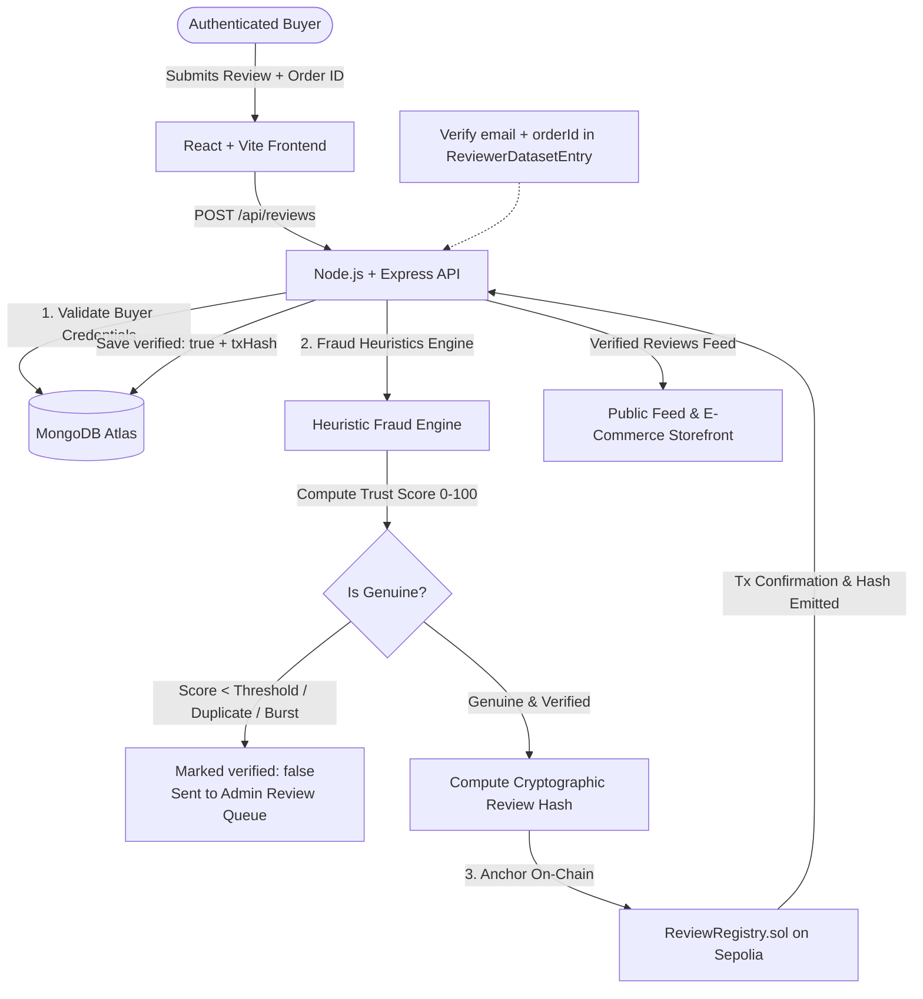

# 🛡️ Blockchain-Based Fake Product Review Detection System

[](https://soliditylang.org/)
[](https://hardhat.org/)
[](https://react.dev/)
[](https://nodejs.org/)
[](https://www.mongodb.com/)
[](https://tailwindcss.com/)
[](LICENSE)

A production-ready full-stack decentralized application (dApp) for authenticated buyers to submit product reviews, detect fraudulent and spam patterns through heuristic scoring, validate purchases by order ID, and publish only genuine verified reviews immutably anchored to the Ethereum blockchain.

---

## 📌 Table of Contents
- [Architecture & Flow](#-architecture--system-flow)
- [Key Features](#-key-features)
- [Tech Stack](#-tech-stack)
- [Project Structure](#-project-structure)
- [Getting Started](#-getting-started)
  - [Environment Setup](#1-environment-setup)
  - [Smart Contract Deployment](#2-smart-contract-deployment-sepolia)
  - [Running the Backend](#3-running-the-backend)
  - [Running the Frontend](#4-running-the-frontend)
- [API Endpoints](#-api-endpoints)
- [Fraud Detection Heuristics](#-fraud-detection-heuristics)
- [Security & Production Notes](#-security--production-notes)

---

## 🏛️ Architecture & System Flow



---

## ✨ Key Features

- **🔐 Cryptographic Order Authentication**: Only buyers with verified matching `email` and `orderId` in the database can submit reviews.
- **🤖 Rule-Based Fraud Detection Engine**:
  - **Duplicate Review Detection**: Flags repeated review text across products.
  - **Same-User Repeat Submissions**: Throttles and detects multiple submissions from identical buyers.
  - **Burst / Frequency Heuristics**: Detects abnormally high submission velocity within tight time windows.
  - **Pattern Similarity Matching**: Analyzes content likeness to catch automated bot templates.
- **📊 Dynamic Trust Scoring**: Computes a transparent `0–100` score and assigns `GENUINE` vs `FAKE` classification.
- **⛓️ Smart Contract Immutability**: All genuine reviews have their unique SHA-256 cryptographic hashes permanently recorded on Ethereum Sepolia ([`ReviewRegistry.sol`](contracts/contracts/ReviewRegistry.sol)).
- **🛡️ Admin Dashboard**: Live analytics, score breakdown charts, and a dedicated queue to inspect unverified/flagged submissions.
- **🌓 Modern UI/UX**: Responsive interface built with Tailwind CSS, Chart.js metrics, dark/light themes, and real-time toast alerts.

---

## 🛠️ Tech Stack

| Layer | Technologies |
| :--- | :--- |
| **Frontend** | React 18, Vite, Tailwind CSS, Axios, Chart.js, Lucide Icons |
| **Backend** | Node.js, Express.js, Mongoose, JSON Web Tokens (JWT), CORS |
| **Database** | MongoDB Atlas / Local MongoDB |
| **Smart Contracts** | Solidity (`^0.8.24`), Hardhat, Ethers.js, Sepolia Testnet |

---

## 📂 Project Structure

```text
├── client/                 # React frontend (Vite + Tailwind CSS + Chart.js)
│   ├── src/
│   │   ├── components/     # UI, Navigation, Analytics Charts & Modals
│   │   ├── pages/          # Home, SubmitReview, AdminDashboard, Auth
│   │   └── services/       # Axios API integrations
├── server/                 # Express REST API backend
│   ├── controllers/        # Auth, review submissions, heuristics & dataset
│   ├── models/             # User, Review, ReviewerDatasetEntry schemas
│   ├── routes/             # /api/auth, /api/reviews, /api/dataset
│   └── utils/              # Fraud detection heuristics & blockchain helper
├── contracts/              # Solidity Smart Contracts & Hardhat environment
│   ├── contracts/          # ReviewRegistry.sol
│   ├── scripts/            # Deployment scripts
│   └── test/               # Contract test suite
└── hardhat.config.js       # Hardhat network & compiler configuration
```

---

## 🚀 Getting Started

### Prerequisites
- Node.js (v18 or higher)
- npm or yarn
- MongoDB Atlas account (or local MongoDB)
- Ethereum wallet (MetaMask) with Sepolia testnet ETH

---

### 1. Environment Setup

Create a `.env` file in the project root:

```env
MONGO_URI=mongodb+srv://<username>:<password>@cluster0.mongodb.net/blockchain-review?retryWrites=true&w=majority
JWT_SECRET=your_super_secret_jwt_key
PORT=5000
CLIENT_URL=http://localhost:5173
VITE_API_BASE_URL=http://localhost:5000/api

# Blockchain Configuration (Optional for mock testing, required for on-chain registry)
RPC_URL=https://eth-sepolia.g.alchemy.com/v2/your_alchemy_key
PRIVATE_KEY=your_wallet_private_key
CONTRACT_ADDRESS=your_deployed_contract_address
```

---

### 2. Smart Contract Deployment (Sepolia)

1. Install contract workspace dependencies:
   ```bash
   cd contracts
   npm install
   ```
2. Compile the Solidity contract:
   ```bash
   npx hardhat compile
   ```
3. Deploy to Sepolia testnet:
   ```bash
   npx hardhat run scripts/deploy.js --network sepolia
   ```
4. Copy the logged contract address into `CONTRACT_ADDRESS` in your root `.env`.

---

### 3. Running the Backend

```bash
cd server
npm install
npm run dev
```
The API server will launch on `http://localhost:5000`.

---

### 4. Running the Frontend

```bash
cd client
npm install
npm run dev
```
The frontend interface will open on `http://localhost:5173`.

---

## 🔌 API Endpoints

| Method | Endpoint | Description | Auth Required |
| :--- | :--- | :--- | :--- |
| `POST` | `/api/auth/register` | Register a new user account | No |
| `POST` | `/api/auth/login` | Authenticate and obtain JWT token | No |
| `GET` | `/api/dataset` | Fetch list of approved reviewer purchase orders | Yes |
| `POST` | `/api/reviews` | Submit product review & evaluate fraud score | Yes |
| `GET` | `/api/reviews` | Retrieve all reviews (Admin queue view) | Yes |
| `GET` | `/api/reviews/public` | Retrieve verified genuine reviews only | No |
| `GET` | `/api/reviews/:id` | Get details and verification metadata by ID | No |
| `GET` | `/api/health` | API health check status | No |

---

## 🧠 Fraud Detection Heuristics

When a review is submitted, the backend passes it through the multi-check verification pipeline:
1. **Identity & Order Check**: Verifies that `user.email` + `orderId` exists in `ReviewerDatasetEntry`.
2. **Frequency Throttling**: Checks how many reviews were submitted by this user/order in the preceding time period.
3. **Duplicate Content Engine**: Checks hash and token similarity against recent reviews across the system.
4. **Trust Score Computation**: Reviews scoring above the threshold are marked `verified: true` and submitted to the blockchain registry; otherwise, they are quarantined for admin inspection.

---

## 🔒 Security & Production Notes

- **Secrets Handling**: Zero credentials or private keys are tracked in version control.
- **JWT Protection**: Protected routes require valid bearer tokens.
- **Auditability**: On-chain hash provides an unalterable timestamp and proof of review existence.

---

## 👩‍💻 Author

**Anjali Singh**
- GitHub: [@anjali-singh15](https://github.com/anjali-singh15)
- Repository: [blockchain-review-system](https://github.com/anjali-singh15/blockchain-review-system)
